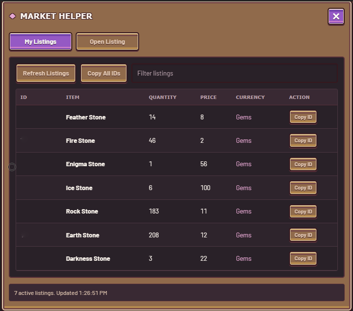
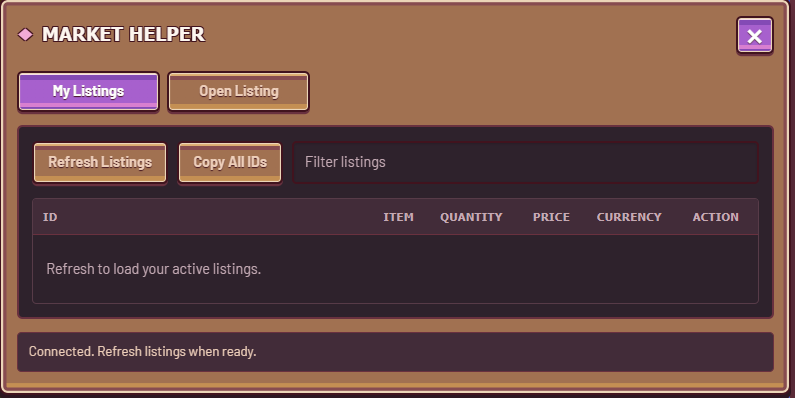
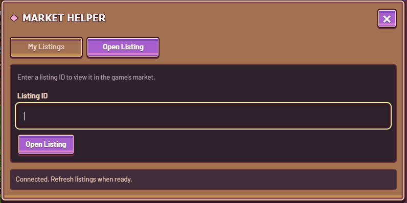
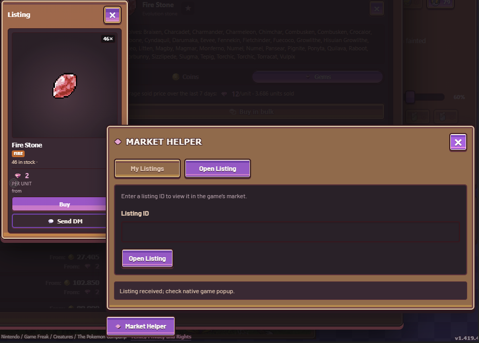

<div align="center">

# PokeIdle Market Helper

View your Community Market listings and open a listing by ID inside PokeIdle.


**Tested in IdleDeck** · Loadable as an unpacked Chromium extension

[Download source](https://github.com/opiekun/pokeidle-market-helper/archive/refs/heads/main.zip) · [Report an issue](https://github.com/opiekun/pokeidle-market-helper/issues)



<sub>My Listings in IdleDeck. Listing IDs hidden in the screenshot.</sub>

</div>

---

## What it does

A **Market Helper** button appears in the bottom-right corner of [PokeIdle](https://pokeidle.io). It opens a panel with two tabs, styled to match the game’s menus.


### My Listings

- Refresh the active listings belonging to the account you are playing.
- See each listing’s ID, item or Pokémon name, quantity, price, and currency.
- Filter by name or listing ID.
- Copy one ID or all loaded IDs.

<details>
<summary>Panel before refreshing</summary>



</details>

### Open Listing

Paste a listing ID to open it through the game’s native market interface. Works with item and Pokémon listings. You can copy an ID from your seller account and open it on your buyer account.



The helper uses the game’s current session. Buying remains a manual action in the game.

## Install

### IdleDeck

Requires [Node.js](https://nodejs.org) to run the installer.

1. Download and extract the source ZIP, or clone this repository.
2. Fully quit IdleDeck, including its tray icon.
3. Open a terminal in the extracted project folder and run:

   ```sh
   node install.mjs
   ```

4. Reopen IdleDeck and connect to PokeIdle.
5. Click **Market Helper** in the bottom-right corner.

The installer adds the helper to every configured slot, preserves other extensions, and backs up IdleDeck’s configuration before changing it. It refuses to install while IdleDeck is running.

To check the installation target without making changes:

```sh
node install.mjs --dry-run
```

For a custom IdleDeck data folder:

```sh
node install.mjs --data "path/to/IdleDeck"
```

Keep the generated `identity.json` file when updating. It preserves the extension’s ID in IdleDeck. It is local to your installation and excluded from Git.

### Chrome, Edge, and other Chromium browsers

1. Download and extract the source ZIP.
2. Open your browser’s extensions page: `chrome://extensions` or `edge://extensions`.
3. Enable **Developer mode**.
4. Choose **Load unpacked** and select the folder containing `manifest.json`.
5. Reload PokeIdle and connect normally.

No build step required. IdleDeck has been tested; other Chromium browsers still need individual verification. Firefox is not supported by this manifest.

## Use it across two accounts

1. On the seller account, open **Market Helper → My Listings**.
2. Click **Refresh Listings**, then **Copy ID** beside the listing you want.
3. On the buyer account, open **Market Helper → Open Listing**.
4. Paste the ID and click **Open Listing**.
5. Review the listing in the game’s own market window.



*An item listing opened through Market Helper. The purchase button belongs to the game.*

## Update

Replace the source files with the latest version.

- **IdleDeck:** keep `identity.json`, fully quit IdleDeck, run `node install.mjs` again, then reopen it.
- **Chromium:** click **Reload** on the extension’s card, then reload PokeIdle.

## Troubleshooting

| Problem | What to check |
| --- | --- |
| Button does not appear | Make sure the extension is enabled for the slot or browser, then reload PokeIdle. |
| No response after refresh | Connect to the game. If you just installed the helper, reload the game so it can observe the connection from startup. |
| Empty listing table | Click Refresh Listings on the account that owns the listings. Only active listings are shown. |
| Listing unavailable | It may have sold, expired, or closed. Check its status on the seller account. |
| Copy fails | Clipboard access may be blocked. Select the displayed ID and copy it manually. |
| Installer says IdleDeck is running | Quit from the tray as well as closing the window. |

Refreshing is manual. Disconnecting clears the displayed listings; refresh again after reconnecting. If the game changes its market handlers, the helper may need an update.

## Privacy and scope

- Uses the account already logged into PokeIdle.
- Does not copy sessions between accounts or store authentication tokens.
- No external server or telemetry.
- No automatic purchases, sales, or currency transfers.
- Works independently of PokeIdle Piloto.

## Development

Plain JavaScript, with no dependencies or build tools required.

| File | Purpose |
| --- | --- |
| `manifest.json` | Extension configuration and PokeIdle page matching |
| `bridge.js` | Page-side connection observation and native listing navigation |
| `ui.js` | Isolated panel, table, filtering, and clipboard actions |
| `install.mjs` | IdleDeck installation and configuration backup |
| `test.cjs` | Mocked bridge tests |
| `test-install.cjs` | Installer tests against temporary fixtures |

Run checks with Node.js:

```sh
node --check bridge.js
node --check ui.js
node --check install.mjs
node test.cjs
node test-install.cjs
```

Tests cover request handling, active-listing filtering, ID validation, disconnects, and repeat installation. They do not replace testing against the live game.

## Credits

Integration approach studied from [PokeIdle Piloto](https://github.com/DredsGG/pokeidle-piloto). Independent project, not affiliated with PokeIdle or Pokémon.
